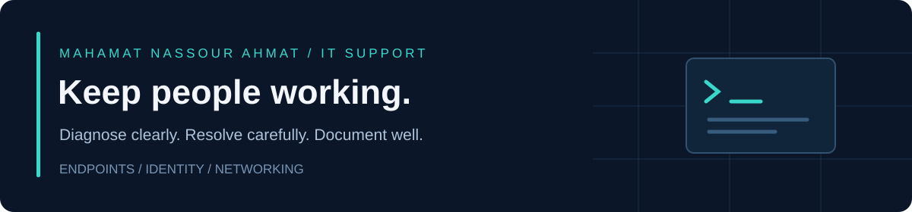

# Mahamat Nassour Ahmat

**IT Support Specialist at USEReady · CompTIA CySA+ · Working toward Systems Administration**

[LinkedIn](https://www.linkedin.com/in/chadian/) · [Email](mailto:mhtnsrpro@gmail.com) · Jersey City, NJ

I work in IT support, helping users with Windows and macOS devices, account access, hardware, and connectivity. I have 2 years of experience and a bachelor's degree in Computer Science from Universite de Ndjamena.

This is where I keep personal support tools, troubleshooting notes, and systems administration exercises. These projects started in November 2026 and are separate from my work at USEReady.

## Projects to explore

| Project | What is available |
| --- | --- |
| [Support playbook](https://github.com/Mhtnsr/it-support-playbook) | Five runbooks, an endpoint snapshot script, and incident handoff templates |
| [Network diagnostics](https://github.com/Mhtnsr/network-diagnostics-toolkit) | A single-host Python report for DNS and optional TCP, ping, and route checks |
| [CSV user plans](https://github.com/Mhtnsr/csv-user-provisioning) | A CSV validator that produces reviewable account plans without changing a directory |

Four code repositories now run automated checks on GitHub. The [Windows snapshot write-up](https://github.com/Mhtnsr/it-support-playbook/blob/main/evidence/windows-runner-validation.md) includes a successful hosted Windows run and its actual output. Each project records the test scope and remaining personal lab work.

## Learning in progress

- [Active Directory account lifecycle](https://github.com/Mhtnsr/ad-lifecycle-lab): a lab-scoped Create/Disable prototype with plan-only and WhatIf modes. Directory changes are covered with mocks, not a live domain test.
- [Endpoint deployment notes](https://github.com/Mhtnsr/endpoint-deployment-notes): a Windows 11/Intune pilot and recovery plan; not a completed rollout.
- [Home lab](https://github.com/Mhtnsr/homelab): a proposed Hyper-V design and build sequence. The build and recovery tests are still ahead.

## Tools I work with

**Operating systems**  
  

**Cloud & identity**  
    

**Networking**  
  

**Scripting**  
  

**Tools**  
   

## Certification and education

- CompTIA CySA+
- Bachelor's degree in Computer Science — Universite de Ndjamena

I'm interested in IT support and junior systems administration opportunities. My focus is clear troubleshooting, useful documentation, and automation that I can test and explain.

[LinkedIn](https://www.linkedin.com/in/chadian/) · [mhtnsrpro@gmail.com](mailto:mhtnsrpro@gmail.com)
