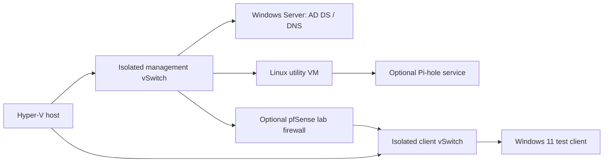

# GitHub presence — Mahamat Nassour Ahmat

Prepared for IT Support → Systems Administrator. Project statuses distinguish tested code, reference material, and planned labs.

## 1. Profile basics

````text
Bio option 1 (recommended):
IT Support Specialist at USEReady | CompTIA CySA+ | Windows, identity & automation | Building toward Systems Administration

Bio option 2:
IT Support Specialist with 2 years of experience. Windows/macOS, AD/Entra ID, Intune, and scripting. Next: Systems Administration.

Bio option 3:
Keeping users productive through practical troubleshooting and clear documentation. IT Support at USEReady | CySA+ | BSc Computer Science

Display name: Mahamat Nassour Ahmat
Username: keep Mhtnsr for continuity. Optional alternatives: mahamat-ahmat, mahamat-nassour, mahamat-it (availability unverified).
Location: Jersey City, NJ
Status: Building my systems administration lab
Company: USEReady (current role, not an endorsement)
Primary website: https://www.linkedin.com/in/chadian/
Public professional email: mhtnsrpro@gmail.com

Link strategy: put LinkedIn in the profile website field and README contact line. Link the six GitHub projects directly. Add a GitHub Pages portfolio only when it has substantive write-ups; do not link an uncreated site. Keep the same name/headline on LinkedIn and your résumé. A neutral professional headshot is better than a generated portrait.
````

## 2. Profile README — Mhtnsr/README.md

````markdown


# Mahamat Nassour Ahmat

**IT Support Specialist at USEReady · CompTIA CySA+ · Building toward Systems Administration**

Jersey City, NJ · [LinkedIn](https://www.linkedin.com/in/chadian/) · [Email](mailto:mhtnsrpro@gmail.com)

## About me

I am an IT Support Specialist with **2 years of experience**, a **bachelor's degree in Computer Science**, and a practical approach to keeping users productive. I support endpoints, identity, and everyday connectivity, then document what the next technician needs to know.

My next step is **Systems Administrator**: deeper Windows administration, identity management, endpoint configuration, and reliable automation.

## What I do

- Troubleshoot Windows/macOS devices, applications, hardware, and remote support issues.
- Support account access across Active Directory, Microsoft 365/Entra ID, and Google Workspace.
- Work with Intune, DNS/DHCP/VPN, and service desk workflows.
- Use PowerShell, Bash, and Python to make repeatable work easier to review.
- Communicate clearly with users and leave useful incident and escalation notes.

## Selected projects

| Project | What to inspect | Status |
| --- | --- | --- |
| [AD lifecycle lab](https://github.com/Mhtnsr/ad-lifecycle-lab) | Plan-first PowerShell, OU scoping, WhatIf | Local plan checks; AD mutation unvalidated |
| [CSV user provisioning](https://github.com/Mhtnsr/csv-user-provisioning) | Input validation, duplicate detection, JSON plans | Tested plan generator; no live provisioning |
| [Network diagnostics](https://github.com/Mhtnsr/network-diagnostics-toolkit) | DNS, optional TCP/ping/route, report structure | Mocked checks and localhost smoke test |
| [Support playbook](https://github.com/Mhtnsr/it-support-playbook) | Runbooks, endpoint snapshot, incident handoffs | Reference library and tested snapshot logic |
| [Endpoint deployment notes](https://github.com/Mhtnsr/endpoint-deployment-notes) | Windows 11/Intune pilot and recovery design | Planned lab documentation |
| [Home lab](https://github.com/Mhtnsr/homelab) | Topology, build sequence, restore evidence template | Planned build |

## Technical toolkit

**Operating systems**  
  

**Cloud & identity**  
    

**Networking**  
  

**Scripting**  
  

**Tools**  
   

## Certification & education

- **CompTIA CySA+** — earned; verification link to be added when supplied.
- **Bachelor's degree in Computer Science** — Universite de Ndjamena.

## GitHub activity

<details>
<summary>View activity cards</summary>

These third-party cards are supplementary and may be unavailable. Language percentages describe repository code, not proficiency; a streak is not a hiring credential.

<picture>
  <source media="(prefers-color-scheme: dark)" srcset="https://github-readme-stats.vercel.app/api?username=Mhtnsr&amp;show_icons=true&amp;hide_rank=true&amp;theme=github_dark&amp;hide_border=true" />
  
</picture>

<picture>
  <source media="(prefers-color-scheme: dark)" srcset="https://streak-stats.demolab.com?user=Mhtnsr&amp;theme=github-dark-blue&amp;hide_border=true" />
  
</picture>

<picture>
  <source media="(prefers-color-scheme: dark)" srcset="https://github-readme-stats.vercel.app/api/top-langs/?username=Mhtnsr&amp;layout=compact&amp;theme=github_dark&amp;hide_border=true" />
  
</picture>

</details>

## Let's connect

Interested in IT support and junior systems administration opportunities, useful automation, and learning from practical infrastructure work.

[LinkedIn](https://www.linkedin.com/in/chadian/) · [mhtnsrpro@gmail.com](mailto:mhtnsrpro@gmail.com)
````

## 3.1. Pinned project — ad-lifecycle-lab

````markdown
Repository: ad-lifecycle-lab
Description: Plan-first Active Directory lifecycle automation scoped to an explicit lab OU.
Topics: powershell, active-directory, identity-management, sysadmin, homelab

# Ad Lifecycle Lab

Plan-first Active Directory lifecycle automation scoped to an explicit lab OU.

**Owner:** [Mahamat Nassour Ahmat](https://github.com/Mhtnsr) · IT Support Specialist → Systems Administrator

## Problem

Unreviewed account changes can affect the wrong directory or user.

## Solution

A dry-run-first PowerShell function with explicit server/OU, input validation, confirmation, and .invalid-domain scope. Create produces a disabled account; Disable checks OU membership before disabling. Entra ID offboarding is a separate design checklist, not implemented cloud automation.

## Usage

Run from the repository root. Use an isolated, authorized environment and inspect source before execution.

```powershell
. ./scripts/Invoke-LabUserLifecycle.ps1
Invoke-LabUserLifecycle -Action Create -SamAccountName lab.user01 -Server dc01.lab.invalid -LabOU 'OU=Lab,DC=lab,DC=invalid'
# Preview explicit apply (no change):
Invoke-LabUserLifecycle -Action Disable -SamAccountName lab.user01 -Server dc01.lab.invalid -LabOU 'OU=Lab,DC=lab,DC=invalid' -Apply -WhatIf
# Only in your isolated .invalid lab, after reviewing the plan:
# Invoke-LabUserLifecycle ... -Apply  # prompts for confirmation
./tests/Test-Lifecycle.ps1
```

## Validation and limits

Five local plan/validation checks passed; real Active Directory mutation is not lab-validated. Requires Windows RSAT/ActiveDirectory module and delegated lab permissions for Apply. No passwords, group grants, deletions, mailbox actions, or Entra session revocation are implemented.

## Screenshots and evidence

[Evidence checklist](evidence/README.md). Placeholder: add a sanitized capture of the actual execution or lab result here after validation. No screenshots or outcomes are fabricated.

<!-- Example after creating the file:  -->

## Repository map

Source belongs in `scripts/`, reproducible checks in `tests/`, synthetic inputs in `examples/`, design notes in `docs/`, reusable records in `templates/`, and sanitized proof in `evidence/`. Only directories relevant to this project are created.

## Next steps

- Capture a reproducible lab run with expected versus observed behavior.
- Document failure cases and recovery or escalation.
- Update validation status only after recording actual results.

## Security

See [SECURITY.md](SECURITY.md). No company data, credentials, internal topology, or live ticket details belong here.

## License

[MIT](LICENSE). A personal learning project; not affiliated with or endorsed by USEReady, Microsoft, CompTIA, or other vendors.
````

## Script — ad-lifecycle-lab/scripts/Invoke-LabUserLifecycle.ps1

````powershell
function Invoke-LabUserLifecycle {
    <# Lab AD only. Dry-run returns a plan without loading AD or connecting.
       -Apply requests a change; -WhatIf and -Confirm are supported.
       Create makes a disabled account with no password. Disable only disables.
       Entra sessions, licenses, mailboxes, and retention are separate workflows. #>
    [CmdletBinding(SupportsShouldProcess=$true, ConfirmImpact='High')]
    param(
        [Parameter(Mandatory)][ValidateSet('Create','Disable')][string]$Action,
        [Parameter(Mandatory)][ValidatePattern('^[a-zA-Z][a-zA-Z0-9._-]{0,19}$')][string]$SamAccountName,
        [Parameter(Mandatory)][ValidateNotNullOrEmpty()][string]$Server,
        [Parameter(Mandatory)][ValidatePattern('(?i)^OU=(Lab|Sandbox),')][string]$LabOU,
        [switch]$Apply
    )
    $plan = [pscustomobject]@{ Action=$Action; Account=$SamAccountName; Server=$Server; OU=$LabOU; Status='Planned' }
    if (-not $Apply) { return $plan }
    if (-not $PSCmdlet.ShouldProcess("$SamAccountName on $Server in $LabOU", $Action)) {
        $plan.Status='NotApplied'; return $plan
    }
    Import-Module ActiveDirectory -ErrorAction Stop
    $ou = Get-ADOrganizationalUnit -Identity $LabOU -Server $Server -ErrorAction Stop
    $domain = Get-ADDomain -Server $Server -ErrorAction Stop
    if ($domain.DNSRoot -notlike '*.invalid') { throw 'Only .invalid lab domains are permitted.' }
    if ($Action -eq 'Create') {
        New-ADUser -Name $SamAccountName -SamAccountName $SamAccountName `
            -Path $ou.DistinguishedName -Server $Server -Enabled $false -ErrorAction Stop
    } else {
        $user = Get-ADUser -Identity $SamAccountName -Server $Server -ErrorAction Stop
        if (-not $user.DistinguishedName.EndsWith(',' + $ou.DistinguishedName, [StringComparison]::OrdinalIgnoreCase)) {
            throw 'Account is outside the approved lab OU.'
        }
        Disable-ADAccount -Identity $user.DistinguishedName -Server $Server -ErrorAction Stop
    }
    $plan.Status='Applied'
    return $plan
}
````

## 3.2. Pinned project — csv-user-provisioning

````markdown
Repository: csv-user-provisioning
Description: Validate synthetic user CSVs and produce reviewable provisioning plans before directory changes.
Topics: python, csv, identity-management, automation, sysadmin

# Csv User Provisioning

Validate synthetic user CSVs and produce reviewable provisioning plans before directory changes.

**Owner:** [Mahamat Nassour Ahmat](https://github.com/Mhtnsr) · IT Support Specialist → Systems Administrator

## Problem

Bulk input errors propagate into identity changes.

## Solution

Validate an exact synthetic CSV schema, normalize usernames, reject duplicates/formula-like/control-character fields, and emit a JSON plan with disabled accounts. The plan is a review artifact; it does not create users.

## Usage

Run from the repository root. Use an isolated, authorized environment and inspect source before execution.

```bash
python scripts/csv_plan.py examples/users.csv
python -m unittest discover -s tests -v
```

## Validation and limits

Python standard library only. Fixture-based validation tests passed. Live provisioning is deliberately not implemented; an approved adapter with uniqueness checks, domain validation, error handling, and rollback would be required.

## Screenshots and evidence

[Evidence checklist](evidence/README.md). Placeholder: add a sanitized capture of the actual execution or lab result here after validation. No screenshots or outcomes are fabricated.

<!-- Example after creating the file:  -->

## Repository map

Source belongs in `scripts/`, reproducible checks in `tests/`, synthetic inputs in `examples/`, design notes in `docs/`, reusable records in `templates/`, and sanitized proof in `evidence/`. Only directories relevant to this project are created.

## Next steps

- Capture a reproducible lab run with expected versus observed behavior.
- Document failure cases and recovery or escalation.
- Update validation status only after recording actual results.

## Security

See [SECURITY.md](SECURITY.md). No company data, credentials, internal topology, or live ticket details belong here.

## License

[MIT](LICENSE). A personal learning project; not affiliated with or endorsed by USEReady, Microsoft, CompTIA, or other vendors.
````

## Script — csv-user-provisioning/scripts/csv_plan.py

````python
"""Validate a synthetic CSV and emit a disabled-account plan; never writes to AD."""
import argparse
import csv
import json
import re
import sys

FIELDS = ['username', 'given_name', 'surname', 'department']

def build_plan(stream):
    reader = csv.DictReader(stream)
    if reader.fieldnames != FIELDS:
        raise ValueError('Expected exact header: ' + ','.join(FIELDS))
    seen, users = set(), []
    for row_number, row in enumerate(reader, 2):
        if None in row or any(row.get(k) is None for k in FIELDS):
            raise ValueError(f'Row {row_number}: incorrect column count')
        row = {k: v.strip() for k, v in row.items()}
        if any(not v or len(v) > 80 or any(ord(c) < 32 for c in v) or v[0] in '=+-@' for v in row.values()):
            raise ValueError(f'Row {row_number}: invalid field')
        username = row['username'].lower()
        if not re.fullmatch(r'[a-z][a-z0-9._-]{0,19}', username):
            raise ValueError(f'Row {row_number}: invalid username')
        if username in seen:
            raise ValueError(f'Row {row_number}: duplicate username')
        seen.add(username)
        users.append(dict(row, username=username, enabled=False))
    if not users:
        raise ValueError('CSV contains no user rows')
    return {'schema_version': 1, 'mode': 'plan-only', 'users': users}

def main():
    parser = argparse.ArgumentParser(description=__doc__)
    parser.add_argument('csv_path')
    args = parser.parse_args()
    try:
        with open(args.csv_path, encoding='utf-8-sig', newline='') as source:
            plan = build_plan(source)
        print(json.dumps(plan, indent=2, ensure_ascii=False))
        return 0
    except (OSError, UnicodeError, ValueError, csv.Error) as exc:
        # Do not print file paths, row contents, or exception data that may be private.
        print('Input rejected; check file access, encoding, header, and field validation.', file=sys.stderr)
        return 2

if __name__ == '__main__':
    raise SystemExit(main())
````

## 3.3. Pinned project — network-diagnostics-toolkit

````markdown
Repository: network-diagnostics-toolkit
Description: Single-host DNS, ping, route, and TCP diagnostics with structured JSON reports.
Topics: python, networking, dns, troubleshooting, sysadmin

# Network Diagnostics Toolkit

Single-host DNS, ping, route, and TCP diagnostics with structured JSON reports.

**Owner:** [Mahamat Nassour Ahmat](https://github.com/Mhtnsr) · IT Support Specialist → Systems Administrator

## Problem

Ad hoc network checks are difficult to compare and hand off.

## Solution

Collect DNS results for one explicit host; optionally run ping, bounded route tracing, and up to eight TCP port checks. No network ranges or discovery scanning. JSON supports consistent incident notes.

## Usage

Run from the repository root. Use an isolated, authorized environment and inspect source before execution.

```bash
python scripts/net_report.py --host localhost
# Opt-in checks on your own local endpoint only:
python scripts/net_report.py --host localhost --ports 443 --probe --ping --route
python -m unittest discover -s tests -v
```

## Validation and limits

Mocked tests and a localhost-only smoke run validate selected paths. Windows/Linux command availability varies; DNS resolution has OS-controlled timeout behavior. TCP success is not an application health check. Reports may contain addresses and routes: keep them private until sanitized.

## Screenshots and evidence

[Evidence checklist](evidence/README.md). Placeholder: add a sanitized capture of the actual execution or lab result here after validation. No screenshots or outcomes are fabricated.

<!-- Example after creating the file:  -->

## Repository map

Source belongs in `scripts/`, reproducible checks in `tests/`, synthetic inputs in `examples/`, design notes in `docs/`, reusable records in `templates/`, and sanitized proof in `evidence/`. Only directories relevant to this project are created.

## Next steps

- Capture a reproducible lab run with expected versus observed behavior.
- Document failure cases and recovery or escalation.
- Update validation status only after recording actual results.

## Security

See [SECURITY.md](SECURITY.md). No company data, credentials, internal topology, or live ticket details belong here.

## License

[MIT](LICENSE). A personal learning project; not affiliated with or endorsed by USEReady, Microsoft, CompTIA, or other vendors.
````

## Script — network-diagnostics-toolkit/scripts/net_report.py

````python
"""Single authorized host only. DNS by default; TCP/ping/route are explicit opt-ins."""
import argparse
import datetime
import ipaddress
import json
import platform
import re
import shutil
import socket
import subprocess

def validate_host(value):
    try:
        return str(ipaddress.ip_address(value))
    except ValueError:
        labels=value.rstrip('.').split('.')
        if len(value)>253 or not all(re.fullmatch(r'[A-Za-z0-9](?:[A-Za-z0-9-]{0,61}[A-Za-z0-9])?', p) for p in labels):
            raise argparse.ArgumentTypeError('Provide a hostname or IP address, not a URL or command option')
        return value

def parse_ports(value):
    try: ports=list(dict.fromkeys(int(p.strip()) for p in value.split(',')))
    except ValueError: raise argparse.ArgumentTypeError('Ports must be comma-separated integers')
    if not ports or len(ports)>8 or any(p<1 or p>65535 for p in ports):
        raise argparse.ArgumentTypeError('Choose one to eight ports in 1..65535')
    return ports

def command_check(tool, args, timeout):
    executable=shutil.which(tool)
    if not executable: return {'status':'unavailable'}
    try:
        result=subprocess.run([executable]+args, capture_output=True, text=True, errors='replace', timeout=timeout, check=False)
        return {'status':'completed','returncode':result.returncode,'output':(result.stdout+result.stderr)[:12000]}
    except subprocess.TimeoutExpired: return {'status':'timeout'}
    except OSError: return {'status':'unavailable'}

def collect(host, ports, probe=False, ping=False, route=False):
    report={'schema_version':1,'timestamp_utc':datetime.datetime.now(datetime.timezone.utc).isoformat(),
            'host':host,'dns':{'status':'unavailable'},'tcp':[],'ping':{'status':'not-requested'},'route':{'status':'not-requested'}}
    # OS resolver timeout behavior is platform-specific; getaddrinfo has no portable timeout.
    try:
        addresses=sorted({item[4][0] for item in socket.getaddrinfo(host, None, type=socket.SOCK_STREAM)})
        report['dns']={'status':'resolved','addresses':addresses}
    except OSError: report['dns']={'status':'failed'}
    if probe:
        for port in ports:
            try:
                with socket.create_connection((host,port),timeout=3): pass
                state='connected'
            except OSError: state='failed'
            report['tcp'].append({'port':port,'status':state})
    windows=platform.system()=='Windows'
    if ping: report['ping']=command_check('ping',(['-n','2'] if windows else ['-c','2'])+[host],12)
    if route: report['route']=command_check('tracert' if windows else 'traceroute',(['-d','-h','8','-w','500'] if windows else ['-n','-m','8','-w','1'])+[host],20)
    return report

def main():
    parser=argparse.ArgumentParser(description=__doc__)
    parser.add_argument('--host',required=True,type=validate_host)
    parser.add_argument('--ports',type=parse_ports,default=[443])
    parser.add_argument('--probe',action='store_true')
    parser.add_argument('--ping',action='store_true')
    parser.add_argument('--route',action='store_true')
    args=parser.parse_args()
    print(json.dumps(collect(args.host,args.ports,args.probe,args.ping,args.route),indent=2))
if __name__=='__main__': main()
````

## 3.4. Pinned project — it-support-playbook

````markdown
Repository: it-support-playbook
Description: IT support runbooks, PowerShell endpoint triage, incident templates, and escalation practice.
Topics: it-support, powershell, troubleshooting, runbooks, servicedesk

# It Support Playbook

IT support runbooks, PowerShell endpoint triage, incident templates, and escalation practice.

**Owner:** [Mahamat Nassour Ahmat](https://github.com/Mhtnsr) · IT Support Specialist → Systems Administrator

## Problem

Support knowledge is easily lost between tickets and technicians.

## Solution

Five focused runbooks, a read-only Windows snapshot utility, reusable user responses, and clear escalation and incident templates.

## Usage

Run from the repository root. Use an isolated, authorized environment and inspect source before execution.

```powershell
./toolkit/Get-SupportSnapshot.ps1
./toolkit/Test-SupportSnapshot.ps1
```

## Validation and limits

Snapshot: 17 synthetic assertions passed in the earlier validation. Live collectors were unavailable in the authoring environment. Runbooks are reference material; no workplace incidents or achieved SLA metrics are claimed.

## Screenshots and evidence

[Evidence checklist](evidence/README.md). Placeholder: add a sanitized capture of the actual execution or lab result here after validation. No screenshots or outcomes are fabricated.

<!-- Example after creating the file:  -->

## Repository map

Source belongs in `scripts/`, reproducible checks in `tests/`, synthetic inputs in `examples/`, design notes in `docs/`, reusable records in `templates/`, and sanitized proof in `evidence/`. Only directories relevant to this project are created.

## Next steps

- Capture a reproducible lab run with expected versus observed behavior.
- Document failure cases and recovery or escalation.
- Update validation status only after recording actual results.

## Security

See [SECURITY.md](SECURITY.md). No company data, credentials, internal topology, or live ticket details belong here.

## License

[MIT](LICENSE). A personal learning project; not affiliated with or endorsed by USEReady, Microsoft, CompTIA, or other vendors.
````

## 3.5. Pinned project — endpoint-deployment-notes

````markdown
Repository: endpoint-deployment-notes
Description: Windows 11 and Intune deployment design, pilot checks, rollback, and validation templates.
Topics: windows-11, intune, endpoint-management, documentation, sysadmin

# Endpoint Deployment Notes

Windows 11 and Intune deployment design, pilot checks, rollback, and validation templates.

**Owner:** [Mahamat Nassour Ahmat](https://github.com/Mhtnsr) · IT Support Specialist → Systems Administrator

## Problem

Deployments fail when prerequisites, pilots, and recovery are undocumented.

## Solution

A Windows 11 and Intune lab design that connects enrollment prerequisites to pilot criteria, configuration intent, verification, recovery, and a change record.

## Usage

Run from the repository root. Use an isolated, authorized environment and inspect source before execution.

```text
Start with docs/pilot-plan.md.
Copy templates/change-record.md into a private lab working folder.
Record actual enrollment and rollback results before marking any deployment complete.
```

## Validation and limits

Design documentation only. No tenant policies, enrollment, licensing, device compliance, deployment, or rollback are claimed as completed.

## Screenshots and evidence

[Evidence checklist](evidence/README.md). Placeholder: add a sanitized capture of the actual execution or lab result here after validation. No screenshots or outcomes are fabricated.

<!-- Example after creating the file:  -->

## Repository map

Source belongs in `scripts/`, reproducible checks in `tests/`, synthetic inputs in `examples/`, design notes in `docs/`, reusable records in `templates/`, and sanitized proof in `evidence/`. Only directories relevant to this project are created.

## Next steps

- Capture a reproducible lab run with expected versus observed behavior.
- Document failure cases and recovery or escalation.
- Update validation status only after recording actual results.

## Security

See [SECURITY.md](SECURITY.md). No company data, credentials, internal topology, or live ticket details belong here.

## License

[MIT](LICENSE). A personal learning project; not affiliated with or endorsed by USEReady, Microsoft, CompTIA, or other vendors.
````

## 3.6. Pinned project — homelab

````markdown
Repository: homelab
Description: A planned systems administration lab with topology, build guides, recovery checks, and evidence standards.
Topics: homelab, hyper-v, active-directory, networking, documentation

# Homelab

A planned systems administration lab with topology, build guides, recovery checks, and evidence standards.

**Owner:** [Mahamat Nassour Ahmat](https://github.com/Mhtnsr) · IT Support Specialist → Systems Administrator

## Problem

A list of technologies does not show how services fit together or recover after failure.

## Solution

A planned Hyper-V lab design with segmented virtual networks, AD/DNS/DHCP, an optional firewall and Pi-hole, a build sequence, and backup/restore verification templates.

## Usage

Run from the repository root. Use an isolated, authorized environment and inspect source before execution.

```text
Read docs/architecture.md, then follow docs/build-sequence.md.
Record actual results using templates/lab-report.md.
Render the Mermaid topology in GitHub; replace only synthetic labels.
```

## Validation and limits

Planned design, not an existing deployed lab. Hardware capacity, licenses, addressing, screenshots, failure tests, and recovery evidence remain to be supplied. Hyper-V is the primary design; Proxmox is an alternative, not a second claimed deployment.

## Screenshots and evidence

[Evidence checklist](evidence/README.md). Placeholder: add a sanitized capture of the actual execution or lab result here after validation. No screenshots or outcomes are fabricated.

<!-- Example after creating the file:  -->

## Repository map

Source belongs in `scripts/`, reproducible checks in `tests/`, synthetic inputs in `examples/`, design notes in `docs/`, reusable records in `templates/`, and sanitized proof in `evidence/`. Only directories relevant to this project are created.

## Next steps

- Capture a reproducible lab run with expected versus observed behavior.
- Document failure cases and recovery or escalation.
- Update validation status only after recording actual results.

## Security

See [SECURITY.md](SECURITY.md). No company data, credentials, internal topology, or live ticket details belong here.

## License

[MIT](LICENSE). A personal learning project; not affiliated with or endorsed by USEReady, Microsoft, CompTIA, or other vendors.
````

## 4. Repository standards

````text
Use MIT for personally authored code and documentation; include the full LICENSE in every repo. Do not license employer-owned work or third-party assets as your own.

Recommended structure:
README.md
LICENSE
SECURITY.md
.gitignore
scripts/          implementation
tests/            deterministic checks
examples/         synthetic inputs and clearly labeled sample output
docs/             design, decisions, and limitations
templates/        incident/change/lab records
evidence/         sanitized, real proof only
reports/          ignored local output
data/private/     ignored real input; preferably never place it in the repo

Commit convention:
feat: add disabled-account provisioning plan
fix: reject duplicate usernames before planning
test: cover failed DNS resolution
docs: record actual client-join verification
chore: update repository metadata

One meaningful change per commit. Explain the reason when it is not obvious. Never backdate, create empty commits, or split trivial lines just to inflate activity.

Topic strategy: 4–8 precise lowercase hyphenated topics. Include the domain (identity-management), implementation (powershell/python), and purpose (troubleshooting/sysadmin). Avoid irrelevant popular topics and certification claims. Topics describe contents, not mastery. See repo-metadata.json for all six sets.
````

## 4a. Reusable README template

````markdown
# [Project title]

[One sentence: who it helps and what it does.]

## Problem
[Concrete trigger, affected task, and why existing manual work is difficult.]

## Solution
[Implemented behavior. Separate implemented, designed, and planned features.]

## Requirements
[OS, versions, modules, permissions, inputs, and authorized scope.]

## Usage
[Exact command from repository root, using synthetic input and dry-run first.]

## Validation
[Checks actually run, observed outcome, environment, and limitations.]

## Screenshots
[Add sanitized real screenshot and caption after running. No invented evidence.]

## Recovery / escalation
[Reversal steps, irreversible effects, and when to stop or hand off.]

## Security
[Data collected, outbound requests, privileges, and what must remain private.]

## License
MIT — see LICENSE. Include third-party attribution separately.
````

## 4b. .gitignore

````gitignore
# Credentials and local configuration
.env
.env.*
!.env.example
*.pem
*.key
*.pfx
*.p12
credentials*
# Real inputs and collected evidence stay local
data/private/
reports/
evidence/raw/
*.log
*.evtx
*.pcap
*.pcapng
# VM disks, backups, and installers
*.vhd
*.vhdx
*.vmdk
*.qcow2
*.iso
*.bak
# Runtime/editor files
__pycache__/
*.py[cod]
.venv/
.pytest_cache/
.vscode/
.idea/
.DS_Store
Thumbs.db
````

## 4c. LICENSE — MIT

````text
MIT License

Copyright (c) 2026 Mahamat Nassour Ahmat

Permission is hereby granted, free of charge, to any person obtaining a copy
of this software and associated documentation files (the "Software"), to deal
in the Software without restriction, including without limitation the rights
to use, copy, modify, merge, publish, distribute, sublicense, and/or sell
copies of the Software, and to permit persons to whom the Software is
furnished to do so, subject to the following conditions:

The above copyright notice and this permission notice shall be included in all
copies or substantial portions of the Software.

THE SOFTWARE IS PROVIDED "AS IS", WITHOUT WARRANTY OF ANY KIND, EXPRESS OR
IMPLIED, INCLUDING BUT NOT LIMITED TO THE WARRANTIES OF MERCHANTABILITY,
FITNESS FOR A PARTICULAR PURPOSE AND NONINFRINGEMENT. IN NO EVENT SHALL THE
AUTHORS OR COPYRIGHT HOLDERS BE LIABLE FOR ANY CLAIM, DAMAGES OR OTHER
LIABILITY, WHETHER IN AN ACTION OF CONTRACT, TORT OR OTHERWISE, ARISING FROM,
OUT OF OR IN CONNECTION WITH THE SOFTWARE OR THE USE OR OTHER DEALINGS IN THE
SOFTWARE.
````

## 5. Home lab structure and architecture

````markdown
homelab/
  README.md
  docs/architecture.md
  docs/build-sequence.md
  templates/lab-report.md
  evidence/README.md
  SECURITY.md
  LICENSE
  .gitignore

# Planned lab architecture

Status: design only. All labels are synthetic. No production network is represented.



Start with an internal/private virtual switch; do not connect a lab DHCP server to a
physical workplace LAN. Choose one DHCP authority per lab segment. Document DNS
forwarding and AD DNS dependencies before adding Pi-hole. The sketch is not a
complete routing configuration: add the chosen DHCP location, routes, firewall rules,
and DNS paths after validating them. VLANs are an optional later exercise; separate
virtual switches do not prove that physical VLAN tagging is configured.

Use lab.invalid for synthetic identity examples. Keep real recovery credentials private.
Record actual CPU/RAM/storage constraints before allocating VMs. Proxmox can replace
Hyper-V if chosen later; document one reproducible implementation first.
````

## 6. Activity and credibility plan

````text
30-day credibility plan — start on the day you actually begin; no backdating.

Day 1: Review every published claim and status; correct anything you cannot explain.
Day 2: Run CSV validation on synthetic input; save the actual sanitized outcome.
Day 3: Add one justified invalid-input test and explain the failure it prevents.
Day 4: Read the AD lifecycle source; annotate scope and privilege boundaries.
Day 5: Execute plan/WhatIf checks; document what they do not validate.
Day 6: Inventory owned lab hardware, licenses, and resource limits.
Day 7: Review week-one notes; publish one concise learning write-up if useful.
Day 8: Build the chosen hypervisor environment on owned equipment.
Day 9: Configure isolated virtual switches; document the separation.
Day 10: Build the Windows Server lab and record actual versions.
Day 11: Establish AD/DNS using synthetic identities; record acceptance checks.
Day 12: Build/join one Windows test client; verify identity and DNS behavior.
Day 13: Test the disabled-account create path in the lab with explicit approval.
Day 14: Document one failed case, recovery, and the resulting code/doc change.
Day 15: Test the disable path on an ordinary lab account; verify sign-in behavior.
Day 16: Validate the snapshot tool against a real lab endpoint.
Day 17: Run network checks against a lab host; distinguish ICMP and service results.
Day 18: Write a DNS failure case with expected versus observed behavior.
Day 19: Use the incident template to produce a clean fictional-ticket handoff.
Day 20: Add a Linux VM and document one Bash administration task.
Day 21: Review week-three privacy and evidence quality; improve weak captions.
Day 22: Create an authorized Intune pilot plan; verify current licensing/requirements.
Day 23: Execute enrollment only if a licensed test tenant/device is available; otherwise document the blocker.
Day 24: Validate one harmless app deployment/removal if the pilot exists; otherwise improve the reproducible plan.
Day 25: Back up lab configuration and describe the restore target.
Day 26: Perform a restore test on a disposable target; record actual recovery limits.
Day 27: File a useful upstream documentation issue only if you reproduced it; do not spam projects.
Day 28: Submit a small, relevant contribution with clear evidence if you have one.
Day 29: Write one case study: symptom → evidence → decision → change → verification.
Day 30: Review pins, profile links, cert verification link, project statuses, and next-month priorities.

Commit only when work changes. Research, rest, unsuccessful experiments, and blocked days do not require commits. Weekly evidence is more useful than a perfect streak.

Certification: add the public issuer verification/Credly URL when available. Do not publish certificate IDs, exam reports, or private badges as images without inspecting them. A CS degree is education, not a certification. No additional certs are claimed.

Write-ups: link each to actual repo evidence and explain tradeoffs and failed hypotheses. Contributions: improve relevant docs/tests, preserve upstream attribution, and identify forks as forks.

Profile features:
- Pin the six original projects in the intended order: AD lifecycle, CSV provisioning, diagnostics, support playbook, endpoint notes, homelab.
- GitHub Pages: optional later. For a user site create Mhtnsr.github.io, then Settings → Pages → Deploy from a branch → main/root. Publish only reviewed personal content. Do not show a site URL as live before deployment succeeds.
- Sponsors: optional only if the account is eligible and you offer a maintained public project; not needed for job seeking. Keep payment/tax setup under your control.
- Achievements: optional profile display. Do not manufacture stars, PRs, or activity to earn badges.
- Signed commits: use GitHub's signed web/squash commits or configure your own GPG/SSH signing. Verify the signature in commit details. A Verified badge establishes a signature, not expertise, test quality, or personal authorship of every line.
- Stats cards: included but collapsed to keep attention on evidence. Third-party public endpoints can fail or rate limit; self-host only if worthwhile, storing tokens as secrets rather than in Markdown. Language percentages do not measure skill.
````

## 7. Security and privacy check

````text
# Security and evidence handling

This is a personal portfolio, not an employer system or an approved production tool.
Use an authorized lab and review changes before execution.

Never commit real company/customer data, ticket exports, passwords, tokens, API keys,
private keys, tenant/subscription IDs, internal hostnames/IPs, serial numbers, QR codes,
or screenshots containing names, notifications, account identifiers, or browser tabs.
Use fictional identities, example.invalid domains, and documentation-only addresses.
Private lab addressing can be explained abstractly; do not copy an employer's topology.

Before publishing: inspect git diff --cached, search for identifiers and secrets,
crop screenshots, replace identifying values with synthetic values, remove metadata,
and inspect the rendered files. Blurring alone can leave readable context; opaque
redaction or newly generated synthetic evidence is preferable.

.gitignore is not a security boundary and does not remove tracked files or history.
If a secret is exposed: revoke/rotate it first, remove it from current files and history
with the repository owner's approved process, and check downstream copies and logs.
Do not paste the secret into an issue while reporting it.

Report a suspected secret exposure privately through the owner's LinkedIn contact.
No vulnerability response SLA is promised for these learning projects.

Sanitization workflow:
1. Start from synthetic data instead of editing an employer export.
2. Parameterize host/domain/path/OU inputs; default to plan-only or read-only.
3. Never embed credentials; use approved runtime authentication in private labs.
4. Validate inputs, limit targets, use WhatIf/confirmation where mutations exist.
5. Test rejected inputs and failure behavior before a live lab run.
6. Review staged diffs and all rendered screenshots; run an approved secret scanner.
7. Keep command output local until it is reviewed; do not upload raw logs automatically.
8. Describe sample output as synthetic; preserve upstream code licenses and sources.
````

## Source notes

Sources checked for setup and implementation guidance:
- https://docs.github.com/en/account-and-profile/tutorials/using-your-github-profile-to-enhance-your-resume
- https://docs.github.com/en/account-and-profile/how-tos/profile-customization/pinning-items-to-your-profile
- https://docs.github.com/en/pages/quickstart
- https://docs.github.com/en/authentication/managing-commit-signature-verification/about-commit-signature-verification
- https://learn.microsoft.com/en-us/powershell/module/activedirectory/new-aduser
- https://github.com/anuraghazra/github-readme-stats
- https://github.com/DenverCoder1/github-readme-streak-stats

LinkedIn URL was recovered from the résumé hyperlink. Its public page could not be fetched, so no additional LinkedIn facts are asserted. Location/email are from the résumé. CySA+, current role, two years of experience, and tools were confirmed by the user.
